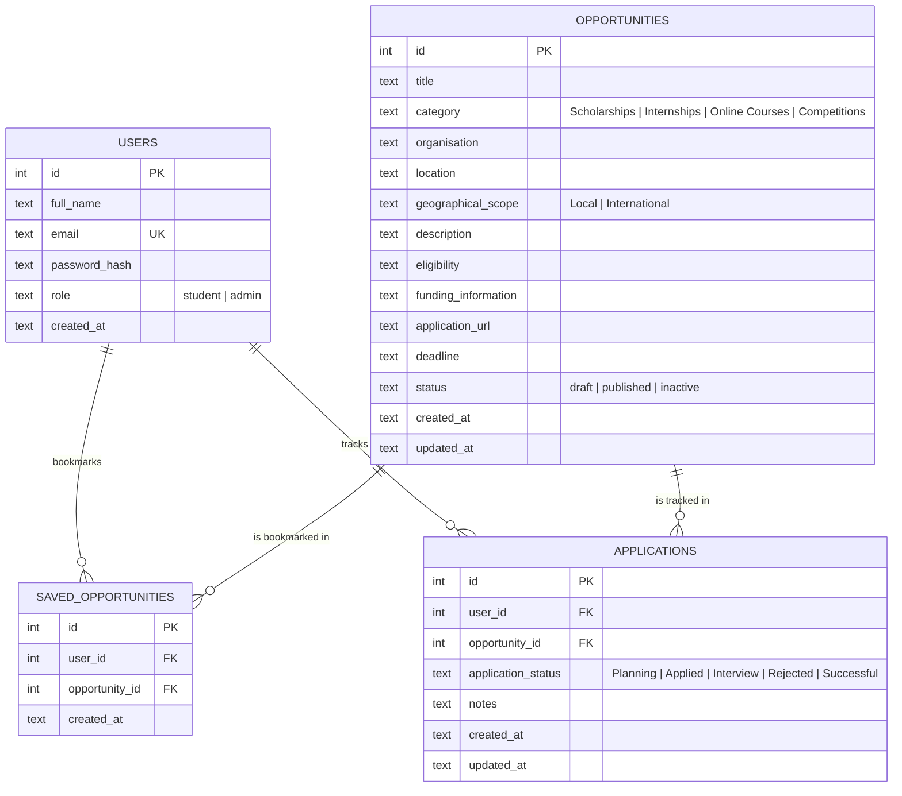

# OpportunityHub: Database Design

## ER diagram
Renders on GitHub, in VS Code (Markdown Preview Mermaid Support extension), or paste into https://mermaid.live.



## Relationships
- `saved_opportunities` and `applications` are **junction tables**: they turn two one-to-many links into many-to-many (a student saves many listings; a listing is saved by many students).
- `UNIQUE (user_id, opportunity_id)` on both tables makes duplicate bookmarks / tracker entries impossible at the database level, not just in Python.
- `ON DELETE CASCADE`: deleting a listing or user removes their bookmarks and tracker rows.
- `CHECK` constraints lock `role`, `category`, `geographical_scope`, `status` and `application_status` to allowed values. Keep them in sync with `constants.py`.

## Design decisions
- **Visibility via `status`:** only `published` rows appear publicly. `inactive` hides expired listings without losing data; `draft` supports "create then publish".
- **Emails stored lowercase** so `Ama@x.com` and `ama@x.com` can't both register.
- **All SQL is in `queries.py`** and parameterised. Student-owned queries always filter by `user_id`, so one student can't read or edit another's records.

## Migrating to PostgreSQL (AWS RDS)
| SQLite | PostgreSQL |
|---|---|
| `INTEGER PRIMARY KEY AUTOINCREMENT` | `INTEGER GENERATED ALWAYS AS IDENTITY PRIMARY KEY` |
| `TEXT` dates | `DATE` for `deadline`, `TIMESTAMPTZ` for `*_at` |
| `?` placeholders | `%s` (psycopg) |
| `LIKE` (case-insensitive for ASCII) | `ILIKE` |
| `cursor.lastrowid` | `INSERT ... RETURNING id` |
| `PRAGMA foreign_keys = ON` | not needed (always enforced) |

`ON CONFLICT ... DO NOTHING` already works in both engines.

## Commands
```
flask --app app init-db     # create tables (safe to repeat)
flask --app app seed-db     # add 7 fictional demo listings if the table is empty
flask --app app reset-db    # drop everything, rebuild, reseed (asks for confirmation)
```
