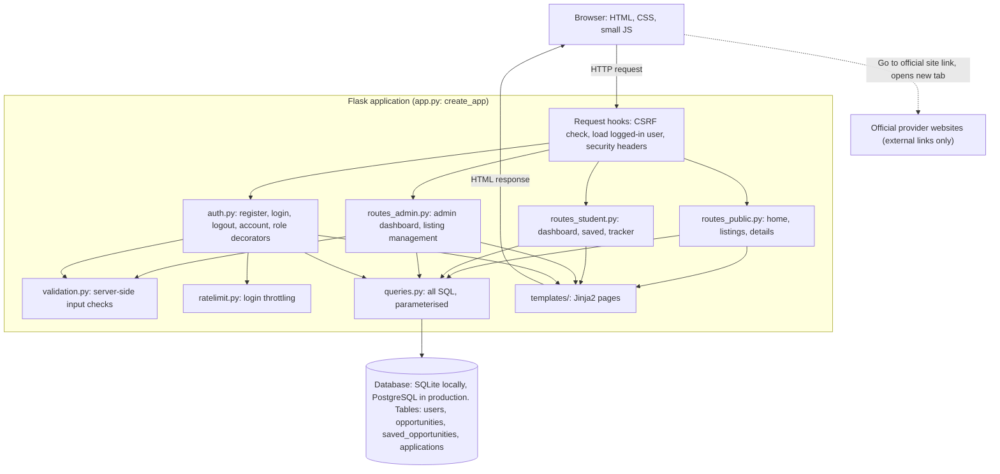
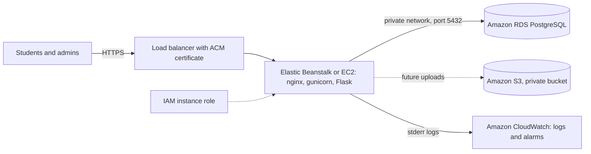

# OpportunityHub: System Architecture

## 1. Overview
OpportunityHub is a server-rendered web application. The browser requests pages from a single Flask application, which reads and writes a relational database and returns HTML built from Jinja2 templates. There is no separate API or front-end framework, which keeps the system small enough for one developer to understand and maintain.

## 2. Architecture diagram
Renders on GitHub, in VS Code with a Mermaid preview extension, or at https://mermaid.live (which can also export PNG/SVG for slides).

## 3. Layers and responsibilities
| Layer | Files | Responsibility |
|---|---|---|
| Presentation | `templates/`, `static/` | Pages, styling, mobile menu, delete confirmation |
| Routing / controllers | `routes_public.py`, `routes_student.py`, `routes_admin.py`, `auth.py` | Receive requests, check permissions, call queries, choose a template |
| Validation | `validation.py` | Reject bad input on the server (never trust the browser) |
| Data access | `queries.py`, `db.py` | The only place SQL is written; one connection per request |
| Storage | `database/schema.sql` | Tables, foreign keys, UNIQUE and CHECK constraints (one file for both SQLite and PostgreSQL) |
| Cross-cutting | `security.py`, `ratelimit.py`, `config.py`, `constants.py` | CSRF, headers, throttling, settings, fixed values |

Rule of thumb: routes never contain SQL, and queries never touch the request. `db.py` wraps SQLite and PostgreSQL behind one small `Database` class (placeholders, case-insensitive search, new-row ids), so the same `queries.py` runs on both. Setting `DATABASE_URL` switches to PostgreSQL.

## 4. Typical request flow: "Save opportunity"
1. Student clicks **Save opportunity** on a details page, which submits a POST form containing a CSRF token.
2. `security.protect_from_csrf` compares the token with the one in the session (400 if wrong).
3. `auth.load_user` loads the logged-in user from the session into `g.user`.
4. `@login_required` on `save_opp` redirects anonymous visitors to the login page.
5. `queries.save_opportunity(user_id, opp_id)` checks the listing is published, then runs `INSERT ... ON CONFLICT DO NOTHING`. The database UNIQUE constraint makes duplicates impossible.
6. The route flashes a message and redirects back to the page; the browser follows with a GET.

## 5. Roles and access control
| Visitor | Can access |
|---|---|
| Anonymous | Home, listings, details, register, login |
| Student | Everything above plus dashboard, saved, tracker, account |
| Administrator | Admin dashboard, student list, listing management, account |

Admin routes use `@admin_required` (403 for students, redirect to login for anonymous users). The role is read from the database on every request, so demoting an account takes effect immediately. Admin accounts are only created from the command line.

## 6. Security controls
| Threat | Control | Where |
|---|---|---|
| Stolen passwords | Werkzeug salted hashes; no plaintext stored | `auth.py` |
| SQL injection | Parameterised queries; column names only from fixed whitelists | `queries.py` |
| Cross-site request forgery | Per-session token checked on every POST | `security.py` |
| Cross-site scripting | Jinja autoescape; Content-Security-Policy; `script-src 'self'` | templates, `security.py` |
| Clickjacking | `X-Frame-Options: DENY`, `frame-ancestors 'none'` | `security.py` |
| Brute-force login | 5 failures per account per IP in 10 minutes, plus an IP-wide cap | `ratelimit.py` |
| Account enumeration (login) | Same message and similar timing for unknown email and wrong password | `auth.py` |
| Session fixation | Session cleared on login | `auth.py` |
| Open redirects | `?next=` only accepts local paths | `auth.safe_next` |
| Privilege escalation | Role never read from forms; admin only via CLI; role checked per request | `auth.py`, `validation.py` |
| Malicious links | Only http(s) URLs accepted; external links use `rel="noopener noreferrer"` | `validation.py`, templates |
| Data exposure | Student queries always filter by the logged-in `user_id` | `queries.py` |
| Cached private pages | `Cache-Control: private, no-store` when logged in | `security.py` |
| Oversized requests | 1 MB body limit | `config.py` |
| Null bytes in input (crash PostgreSQL) | Request rejected with 400 | `security.py` |
| Forged client IP (to dodge rate limits) | `X-Forwarded-For` trusted only from the configured number of proxies | `app.py`, `config.py` |
| Weak production secrets | App refuses to start | `app.py` |
| Insecure transport | Secure cookies and HSTS in production config (needs HTTPS) | `config.py`, `security.py` |

### Known limitations
- Rate-limit counters live in process memory: they reset on restart and are not shared between servers.
- Registration reveals whether an email is already used (a usability trade-off).
- Changing a password does not sign out the user's other sessions.
- There is no email verification or password reset yet.
- Security testing so far is automated plus static scanning; no external penetration test has been done.

## 7. Design decisions
- **Flask + Jinja2, no SPA:** fewer moving parts, works without heavy JavaScript, easy to explain in a seminar.
- **Application factory (`create_app`):** each test gets its own app and temporary database; production and development differ only by config.
- **SQL in one file:** easier to review for injection and to port to PostgreSQL.
- **Status field on opportunities (`draft`, `published`, `inactive`):** hide or retire listings without deleting history.
- **Tracker only records progress:** the app never submits anything to providers, and says so on the details and tracker pages.

## 8. Extension points
| Future feature | Where it plugs in |
|---|---|
| Student profiles | New `profiles` table (or columns), new `routes_student.py` page |
| Recommendations | New function in `queries.py` ranking by profile fields, new section on the dashboard |
| Email reminders | Scheduled job calling `queries.upcoming_deadlines`; email service such as Amazon SES |
| Advanced filters | Extra parameters in `list_opportunities`, extra columns in `schema.sql` |
| Analytics | `get_stats` already returns category and status counts; add a chart library |
| File/image storage | S3 bucket; store only the object key in the database |

## 9. AWS deployment (prepared in Phase 7)

What exists in the code today: PostgreSQL support behind `DATABASE_URL`, a data migration script, `wsgi.py` and a `Procfile` for gunicorn, a `/health` endpoint for the load balancer, trusted-proxy handling, production-safe defaults, and structured log lines for failed logins and admin actions.

Not done yet: an actual deployment, S3 (no feature needs uploads yet), and a shared rate-limit store. Step-by-step instructions, costs, monitoring and teardown are in `aws_deployment_guide.md`.
